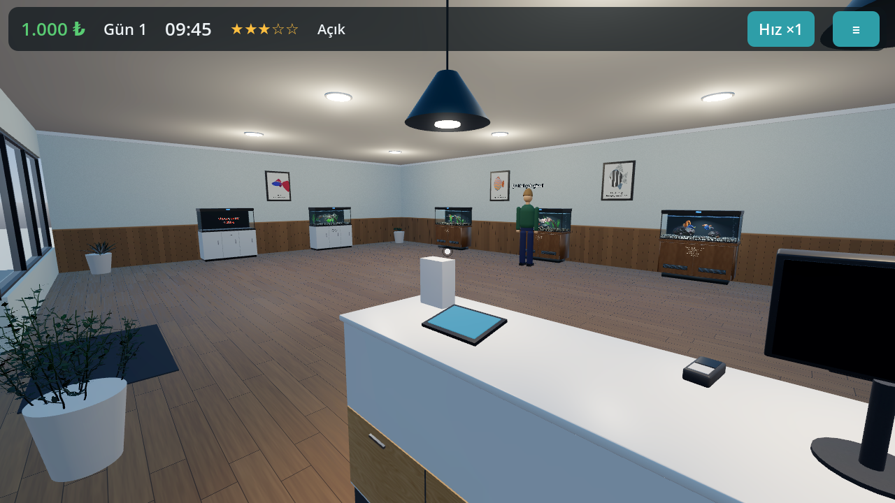
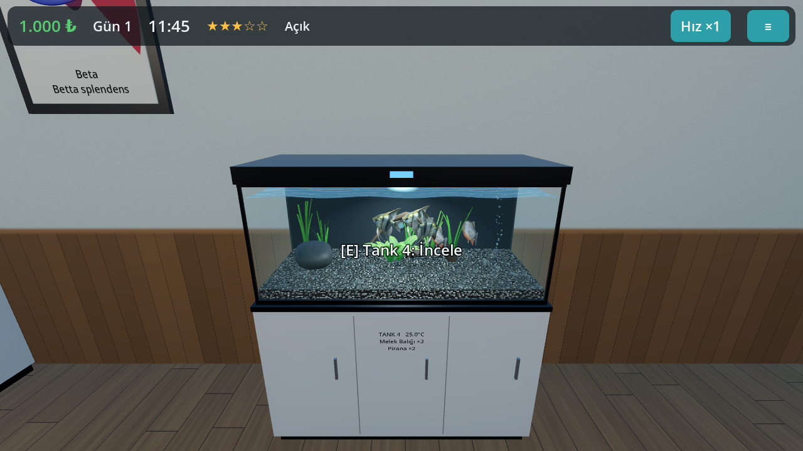
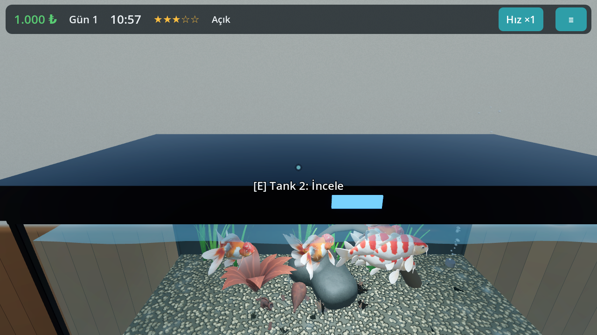

# Akvaryum Dükkânı 🐠

Godot 4 ile yapılmış, birinci şahıs, Türkçe bir **akvaryum dükkânı yönetim oyunu**.
Rahatlatıcı görünür ama seni uğraştırır: su kirlenir, balıklar hastalanır, yanlış türler birbirini yer,
müşteriler pazarlık eder ve kira her gün artar.






## Açmak

1. [Godot 4.4 veya üstü](https://godotengine.org/download) (standart sürüm, .NET gerekmez).
2. Godot'da **İçe Aktar → `project.godot`** dosyasını seç.
3. **F5** ile çalıştır.

## Kontroller

| Bilgisayar | Telefon |
|---|---|
| WASD: yürü | Ekranın sol yarısı: sanal joystick |
| Fare: etrafa bak (önce ekrana tıkla) | Ekranın sağ yarısı: sürükleyerek bak |
| E veya sol tık: etkileşim | **ETKİLEŞ** butonu |
| ESC: menü | ≡ butonu |

## Oynanış

- **Sabah hazırlığı:** Tankları kontrol et, yem ver, suyu değiştir. Hazır olunca **ön kapıdan** dükkânı aç.
- **Gün 09:00–19:00:** Müşteriler gelir, tankları gezer ve yorum yapar
  ("Su çok kirli!", "Ölü balık var!"). Kötü bakım itibarı düşürür.
- **Kasa:** Müşteri sıraya girer. Kasaya bakıp **pazarlık** yaparsın. Fiyatı fazla yükseltirsen sabrı tükenir,
  bekletirsen sinirlenip gider.
- **Tedarik tableti** (kasanın yanında): Balık ve ürün siparişi.
- **Akvaryum bakımı:**
  - Su temizliği, tokluk, sıcaklık (ısıtıcı), filtre seviyesi
  - Beyaz benek hastalığı (ilaç gerekir)
  - Ölü balıklar suyu hızla kirletir, çıkarman gerekir
- **Tür uyumu:**
  - Japon balığı soğuk su ister
  - Beta uzun yüzgeçlilere saldırır
  - Melek balığı neonları yer
  - Diskus çok kazandırır ama çok hassastır
- **Gün sonu:** Kira (her gün artar) ve elektrik ödenir. **3 gün üst üste borçta kalırsan dükkân kapanır.**
- Lepistesler bakımlı tankta yavrular. Kiralık tankları açarak büyüyebilirsin.
- **Tuzlu su (deniz) tankları:** Boş bir tankı tuzlu suya çevirip palyaço balığı (Nemo), mavi cerrah (Dory),
  mandarin, aslan balığı, balon balığı ve deniz atı satabilirsin.

## Balık türleri (17)

| Tatlı su | Tuzlu su |
|---|---|
| Lepistes, Neon Tetra, Zebra Danio, Siyah Moli, Diskus | Palyaço Balığı, Mavi Cerrah, Mandarin |
| Japon Balığı\*, Beta\*, Melek Balığı\*, Koi\* | Aslan Balığı\*, Balon Balığı\*, Deniz Atı\* |
| Pirana\*, Gümüş Arowana\* | |

\* Gerçek 3D modelli türler (Palyaço, Cerrah, Mandarin dahil 12 tür). Diğerleri koddan üretilen modellerle gösterilir.

## Proje yapısı

```
scenes/main.tscn          Ana sahne (her şey koddan kurulur)
scripts/autoload/game.gd  Para, zaman, itibar, stok, kayıt (user://kayit.json)
scripts/data/             Balık türleri (fish_db.gd) ve ürünler (product_db.gd)
scripts/logic/            Görselden bağımsız mantık: su simülasyonu, pazarlık
scripts/world/            Dükkân, akvaryum, balık, müşteri, prosedürel modeller
scripts/player/           Birinci şahıs oyuncu
scripts/ui/hud.gd         Tüm arayüz ve paneller
shaders/                  Balık, cam, su, çakıl+kostik ışık, bitki, parke, duvar
tests/run_tests.gd        Otomatik testler
tools/screenshot.gd       Geliştirici aracı: ekran görüntüsü alır
```

### Yeni balık türü eklemek

`scripts/data/fish_db.gd` içindeki `SPECIES` sözlüğüne bir kayıt ekle.
Gövde şekli, yüzgeçler, renkler ve desen bu alanlardan otomatik üretilir.

## 3D modeller

Projede CC0 lisanslı hazır modeller var: 12 balık, ceviz akvaryum dolabı, kasa tezgâhı, duvar rafları,
saksı bitkileri ve akvaryum dekorları (kaya, amfora, resif, deniz yıldızı...). Kaynaklar için `assets/LISANSLAR.md`.
Hazır balık modelleri animasyonsuz geldiği için yüzme hareketi `shaders/fish_tex.gdshader` ile ekleniyor.

Yeni model eklemek için `.glb` dosyalarını aşağıdaki yerlere koyman yeterli, kod bunları otomatik kullanır:

| Dosya | Yerine geçtiği |
|---|---|
| `assets/models/fish/<tür>.glb` (ör. `neon.glb`, `japon.glb`) | O türün balığı |
| `assets/models/characters/customer.glb` | Müşteri. İçinde `walk` / `idle` animasyonu varsa oynatılır. |

Balık modelinin burnu **+Z** yönüne bakmalı (bu paketteki gibi). Farklıysa `fish_db.gd` içindeki `MODEL_FWD` ile ayarla.
Boyutu tür uzunluğuna göre otomatik ölçeklenir.

Ücretsiz model kaynakları:

- [Quaternius](https://quaternius.com): CC0, stilize hayvan ve karakter paketleri
- [Poly Pizza](https://poly.pizza): Binlerce düşük poligonlu model
- [Kenney](https://kenney.nl/assets): Mobilya ve dükkân eşyaları
- [Poly Haven](https://polyhaven.com) ve [ambientCG](https://ambientcg.com): Dokular
- [Mixamo](https://www.mixamo.com): İnsan karakterleri ve animasyonları
- [Sketchfab](https://sketchfab.com): Lisansı kontrol et, CC-BY ise yapımcının adını belirt

## Android'e aktarmak

1. Godot'da **Editör → Dışa Aktarma Şablonlarını Yönet** menüsünden şablonları indir.
2. **Editör Ayarları → Dışa Aktar → Android** bölümünde Java SDK ve Android SDK yollarını göster.
3. **Proje → Dışa Aktar → Android** (hazır ayar projede var) → APK'yı dışa aktar.

Telefonlarda "Mobile" renderer kullanılır, ekran yatay açılır.

## Testler

```
godot --headless --path . --import
godot --headless --path . --fixed-fps 60 -s res://tests/run_tests.gd
```

Testler şunları kontrol eder:

- Tür uyumu, balık değeri, pazarlık ve su simülasyonu
- Kayıt ve yükleme
- Sahneyi kurup bir iş gününü baştan sona oynatan entegrasyon testi (müşteri gelişi, satış, gün sonu raporu)
