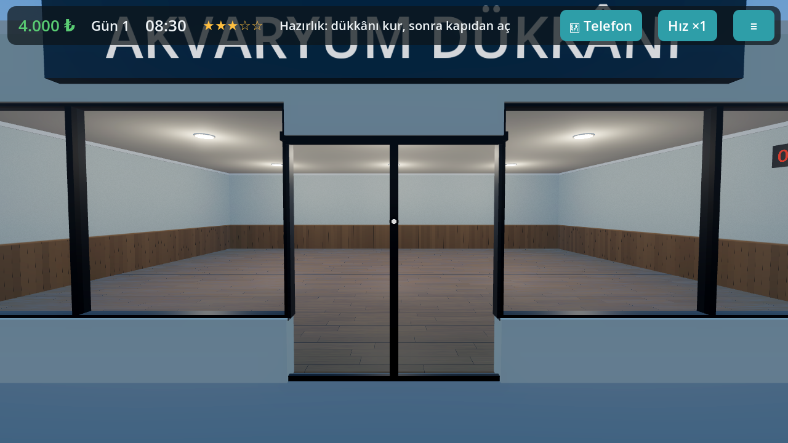
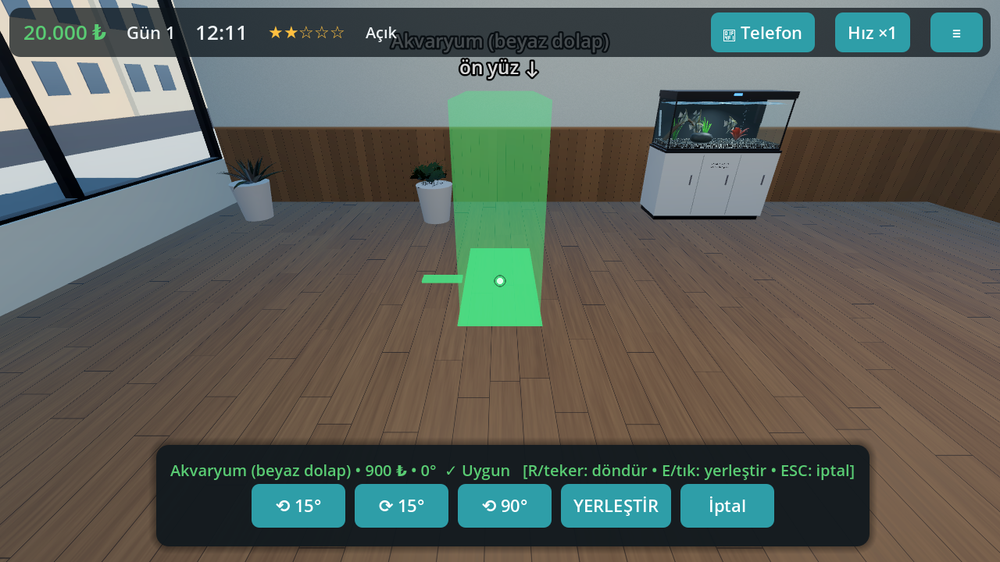
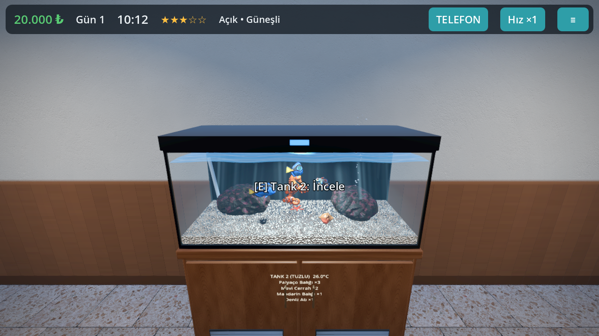
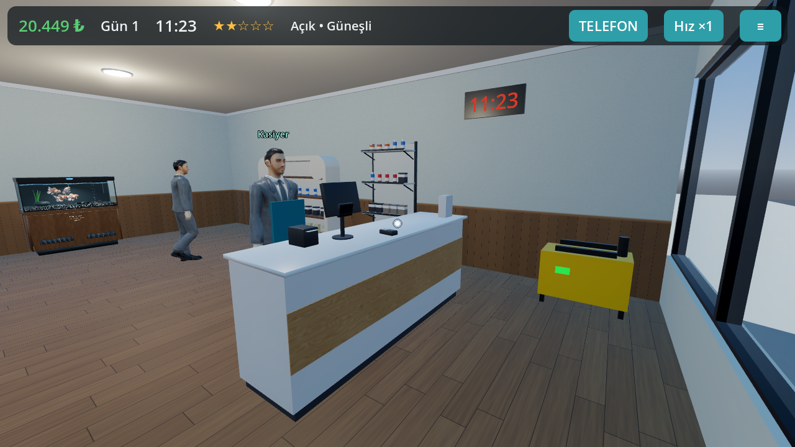
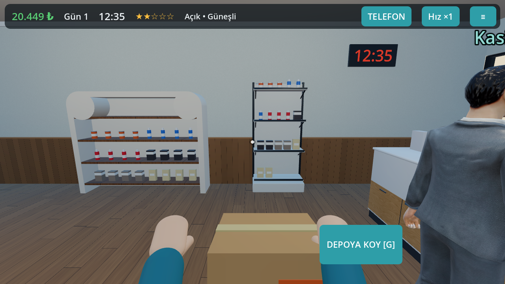
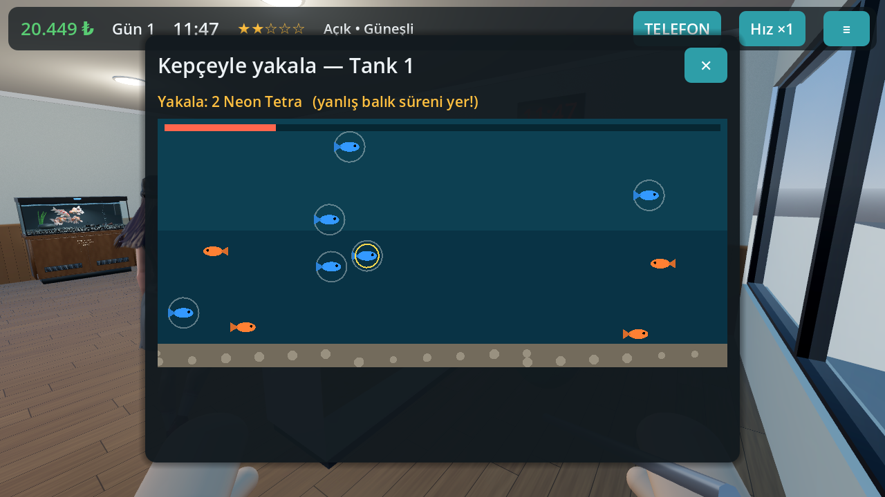
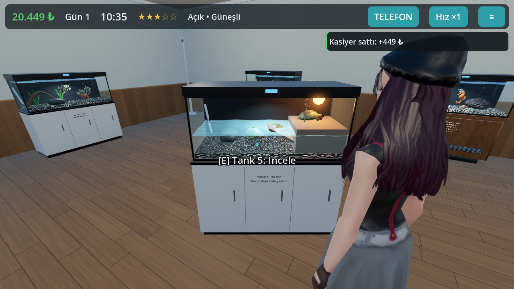
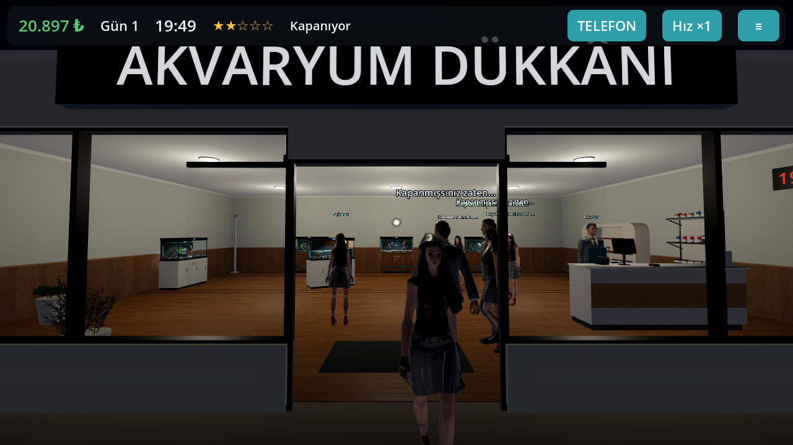

# Akvaryum Dükkânı 🐠

Godot 4 ile yapılmış, birinci şahıs, Türkçe bir **akvaryum dükkânı yönetim oyunu**.
Rahatlatıcı görünür ama seni uğraştırır: su kirlenir, balıklar hastalanır, yanlış türler birbirini yer,
müşteriler pazarlık eder ve kira her gün artar.











## Açmak

1. [Godot 4.4 veya üstü](https://godotengine.org/download) (standart sürüm, .NET gerekmez).
2. Godot'da **İçe Aktar → `project.godot`** dosyasını seç.
3. **F5** ile çalıştır.

## Kontroller

| Bilgisayar | Telefon |
|---|---|
| WASD: yürü | Ekranın sol yarısı: sanal joystick |
| Fare: etrafa bak (önce ekrana tıkla) | Ekranın sağ yarısı: sürükleyerek bak |
| E veya sol tık: etkileşim | **ETKİLEŞ** butonu |
| ESC: menü | ≡ butonu |

## Oynanış

### Dükkânı sıfırdan kur
- Oyuna **dışarıda, boş bir dükkânın önünde** başlarsın. Cebinde 4.000 ₺ var.
- **TELEFON > Mobilya:** Akvaryum (beyaz ya da ceviz dolaplı), kasa tezgâhı, raflar, saksı bitkileri, paspas.
  - Eşya baktığın yere gelir. **15° adımlarla döndür** (R / fare tekeri / ⟲⟳ butonları) ve **YERLEŞTİR**.
  - Çakışırsa ya da kapının önünü kapatırsa kırmızı olur.
  - Eşyalara bakıp **Taşı** ya da **Sat** (yarı fiyatına iade) diyebilirsin.
- **Akvaryum kurulumu:** Tank çıplak gelir.
  - Tankın ekipmanı: kum/çakıl, filtre (3 seviye), ısıtıcı, LED lamba, hava motoru.
  - Dekor: kaya, amfora, kök, su bitkileri; deniz tankında resif kayası, deniz yıldızı, kabuk, deniz kestanesi.
  - **Su olgunlaşması:** Yeni kurulan suda yararlı bakteri yoktur. Hemen balık koyarsan balıklar zorlanır, filtre süreci hızlandırır.
  - **Çekicilik:** Lambasız, kumsuz ve boş tankı müşteriler beğenmez. Lamba, kum, dekor ve temiz su satışları artırır.
- **TELEFON > Balık:** Hedef tankı seçip balık sipariş edersin. Büyük balıklar (arowana, koi) tankta daha çok yer kaplar.
- **TELEFON > Ürün:** Siparişler **depoya** gelir. Rafa bakıp depodan rafa **sen dizersin**. Müşteri sadece raftakini alır.

### İş günü
- Hazır olunca ön kapıdan dükkânı aç (09:00–19:00). **Kasa tezgâhı olmadan dükkân açılmaz.**
- Müşteriler kapıdan girer, eşyaların arasından yol bularak tankları ve rafları gezer, yorum yapar
  ("Bu tank çok karanlık!", "Ölü balık var!").
- Kasada **pazarlık** yaparsın. Kazık atarsan ya da bekletirsen çekip gider.
- Bakım: yem, su değişimi, hastalık (beyaz benek), ölü balıkları çıkarma, tür uyumu, sıcaklık.
- Her akşam artan kira ve elektrik ödenir (ısıtıcı, lamba, filtre). **3 gün üst üste borçta kalırsan dükkân kapanır.**

### Daha fazlası
- **Koliler:** Ürün siparişleri kapının yanına koli olarak gelir. Koliyi eline al, bir rafa bakıp diz ya da depoya koy (G).
- **Dükkânı kişiselleştir:** TELEFON > Dükkân: tabela adı, duvar rengi, zemin. Dükkânı iki kez 4'er metre büyütebilirsin.
- **Personel:** Kasiyer (sen yetişemezsen satışı yapar, şikâyetlere iade eder) ve bakımcı (yem, ölü balık, su değişimi).
- **Gün ve hava:** Akşam dışarısı kararır; günlük hava durumu (yağmurda az müşteri gelir).
- **Elektrik kesintisi:** Isıtıcı, filtre ve lambalar durur. Jeneratör alırsan etkilenmezsin.
- **Müfettiş:** Habersiz gelir; kirli su, ölü balık, hastalık, yanlış sıcaklık görürse ceza keser.
- **Yetiştirme ve nadir balıklar:** Bakımlı tanklarda 9 tür yavrular. Yavruların %3'ü nadir (Albino, Altın...) ve 6 kat değerlidir.
- **Karantina:** Tedarikçiden gelen balıkların bir kısmı hastalık taşır. Önce karantina tankında gözlemle, sonra satış tankına taşı.
- **Kepçe mini oyunu:** Balık satarken kepçeyle doğru balıkları yakala (ayarlardan kapatılabilir).
- **Müşteriler:** İsimli müdavimler (sadakat), şikâyete gelenler (iade/ret), soru soranlar (doğru cevaba bahşiş),
  hırsızlar (güvenlik kamerası yakalar), cama vuran çocuklar (uyar), özel sipariş verenler (%50 fazla öder).
- **Ekonomi:** Günlük değişen toptancı fiyatları, kampanya, sosyal medya (tank fotoğrafı paylaş, takipçi kazan),
  banka kredisi, şube açma, her 7. gün akvaryum yarışması.
- **Kaplumbağa teraryumu:** Karası ve ısı lambası olan teraryumda Hazar kaplumbağası satabilirsin.
- **Sesler:** Kapı zili, kasa, kabarcık, yağmur, alarm... (hepsi kodla sentezlenir).

## Balık ve hayvan türleri (21)

| Tatlı su | Tuzlu su |
|---|---|
| Lepistes, Neon Tetra, Zebra Danio, Siyah Moli, Diskus | Palyaço Balığı, Mavi Cerrah, Mandarin |
| Japon Balığı\*, Beta\*, Melek Balığı\*, Koi\* | Aslan Balığı\*, Balon Balığı\*, Deniz Atı\* |
| Pirana\*, Gümüş Arowana\*, Kedi Balığı\*, Gökkuşağı Alabalığı\* | Fener Balığı\* (nadir) |
| Hazar Kaplumbağası (teraryumda) | |

\* Gerçek 3D modelli türler (Palyaço, Cerrah, Mandarin dahil 15 tür). Diğerleri koddan üretilen modellerle gösterilir.

## Proje yapısı

```
scenes/main.tscn          Ana sahne (her şey koddan kurulur)
scripts/autoload/game.gd  Para, zaman, itibar, stok, kayıt (user://kayit.json)
scripts/data/             Balık türleri (fish_db.gd) ve ürünler (product_db.gd)
scripts/logic/            Görselden bağımsız mantık: su simülasyonu, pazarlık
scripts/world/            Dükkân, akvaryum, balık, müşteri, prosedürel modeller
scripts/player/           Birinci şahıs oyuncu
scripts/ui/hud.gd         Tüm arayüz ve paneller
shaders/                  Balık, cam, su, çakıl+kostik ışık, bitki, parke, duvar
tests/run_tests.gd        Otomatik testler
tools/screenshot.gd       Geliştirici aracı: ekran görüntüsü alır
```

### Yeni balık türü eklemek

`scripts/data/fish_db.gd` içindeki `SPECIES` sözlüğüne bir kayıt ekle.
Gövde şekli, yüzgeçler, renkler ve desen bu alanlardan otomatik üretilir.

## 3D modeller

Projede hazır modeller var: 15 balık, iki animasyonlu müşteri karakteri (yürüme/bekleme), ceviz akvaryum dolabı,
kasa tezgâhı, metal duvar rafı, saksı bitkileri ve akvaryum dekorları. Kaynaklar ve lisanslar `assets/LISANSLAR.md` içinde
(karakterler CC-BY 4.0, gerisi CC0).
Hazır balık modelleri animasyonsuz geldiği için yüzme hareketi `shaders/fish_tex.gdshader` ile ekleniyor.

Yeni model eklemek için `.glb` dosyalarını aşağıdaki yerlere koyman yeterli, kod bunları otomatik kullanır:

| Dosya | Yerine geçtiği |
|---|---|
| `assets/models/fish/<tür>.glb` (ör. `neon.glb`, `japon.glb`) | O türün balığı |
| `assets/models/characters/*.glb` | Müşteri karakterleri (`customer.gd` içindeki `CHARACTERS` listesine ekle). `walk` / `idle` animasyonları oynatılır. |

Balık modelinin burnu **+Z** yönüne bakmalı (bu paketteki gibi). Farklıysa `fish_db.gd` içindeki `MODEL_FWD` ile ayarla.
Boyutu tür uzunluğuna göre otomatik ölçeklenir.

Ücretsiz model kaynakları:

- [Quaternius](https://quaternius.com): CC0, stilize hayvan ve karakter paketleri
- [Poly Pizza](https://poly.pizza): Binlerce düşük poligonlu model
- [Kenney](https://kenney.nl/assets): Mobilya ve dükkân eşyaları
- [Poly Haven](https://polyhaven.com) ve [ambientCG](https://ambientcg.com): Dokular
- [Mixamo](https://www.mixamo.com): İnsan karakterleri ve animasyonları
- [Sketchfab](https://sketchfab.com): Lisansı kontrol et, CC-BY ise yapımcının adını belirt

## Android'e aktarmak

1. Godot'da **Editör → Dışa Aktarma Şablonlarını Yönet** menüsünden şablonları indir.
2. **Editör Ayarları → Dışa Aktar → Android** bölümünde Java SDK ve Android SDK yollarını göster.
3. **Proje → Dışa Aktar → Android** (hazır ayar projede var) → APK'yı dışa aktar.

Telefonlarda "Mobile" renderer kullanılır, ekran yatay açılır.

## Testler

```
godot --headless --path . --import
godot --headless --path . --fixed-fps 60 -s res://tests/run_tests.gd
```

Testler şunları kontrol eder:

- Tür uyumu, balık değeri, pazarlık ve su simülasyonu
- Kayıt ve yükleme
- Sahneyi kurup bir iş gününü baştan sona oynatan entegrasyon testi (müşteri gelişi, satış, gün sonu raporu)
